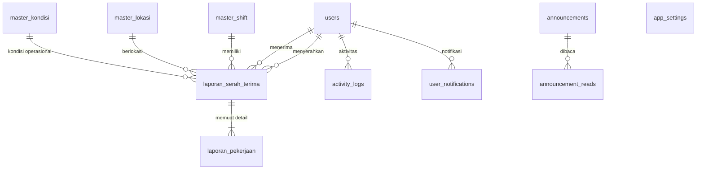

# Dokumentasi Basis Data Lengkap (Database Schema & Indexing)
## Sistem Laporan Serah Terima Shift Operasional (OMIT)

### 1. Daftar Tabel (7 Tabel Inti + 4 Tabel Auto-Migrating)



---

### 2. Skema Tabel Detail

#### 1. Tabel `users`
Menyimpan akun pengguna sistem berjenjang (Superadmin, Admin, User).
```sql
CREATE TABLE `users` (
  `id` INT AUTO_INCREMENT PRIMARY KEY,
  `nama_lengkap` VARCHAR(100) NOT NULL,
  `username` VARCHAR(50) NOT NULL UNIQUE,
  `password` VARCHAR(255) NOT NULL,
  `role` ENUM('superadmin', 'admin', 'user') NOT NULL DEFAULT 'user',
  `jabatan` VARCHAR(100) DEFAULT NULL,
  `email` VARCHAR(150) DEFAULT NULL,
  `no_telepon` VARCHAR(30) DEFAULT NULL,
  `foto` VARCHAR(255) DEFAULT NULL,
  `status` ENUM('aktif', 'nonaktif') NOT NULL DEFAULT 'aktif',
  `created_at` TIMESTAMP DEFAULT CURRENT_TIMESTAMP,
  `updated_at` TIMESTAMP DEFAULT CURRENT_TIMESTAMP ON UPDATE CURRENT_TIMESTAMP,
  INDEX `idx_users_role_status` (`role`, `status`),
  INDEX `idx_users_username` (`username`)
) ENGINE=InnoDB DEFAULT CHARSET=utf8mb4 COLLATE=utf8mb4_unicode_ci;
```

#### 2. Tabel `master_lokasi`
Menyimpan data master pos / area / stasiun kerja operasional.
```sql
CREATE TABLE `master_lokasi` (
  `id` INT AUTO_INCREMENT PRIMARY KEY,
  `nama_lokasi` VARCHAR(100) NOT NULL,
  `keterangan` VARCHAR(255) DEFAULT NULL,
  `status` ENUM('aktif', 'nonaktif') NOT NULL DEFAULT 'aktif',
  `created_at` TIMESTAMP DEFAULT CURRENT_TIMESTAMP,
  INDEX `idx_lokasi_status` (`status`)
) ENGINE=InnoDB DEFAULT CHARSET=utf8mb4 COLLATE=utf8mb4_unicode_ci;
```

#### 3. Tabel `master_shift`
Menyimpan jadwal shift operasional dan jam serah terima resmi.
```sql
CREATE TABLE `master_shift` (
  `id` INT AUTO_INCREMENT PRIMARY KEY,
  `nama_shift` VARCHAR(50) NOT NULL,
  `jam_mulai` TIME NOT NULL,
  `jam_selesai` TIME NOT NULL,
  `jam_serah_terima` TIME DEFAULT NULL,
  `keterangan` VARCHAR(100) DEFAULT NULL,
  `status` ENUM('aktif', 'nonaktif') NOT NULL DEFAULT 'aktif',
  INDEX `idx_shift_status` (`status`)
) ENGINE=InnoDB DEFAULT CHARSET=utf8mb4 COLLATE=utf8mb4_unicode_ci;
```

#### 4. Tabel `master_kondisi`
Menyimpan parameter dinamis pilihan kondisi operasional umum beserta warna badge.
```sql
CREATE TABLE `master_kondisi` (
  `id` INT AUTO_INCREMENT PRIMARY KEY,
  `nama_kondisi` VARCHAR(50) NOT NULL UNIQUE,
  `badge_color` VARCHAR(20) NOT NULL DEFAULT 'emerald',
  `keterangan` VARCHAR(255) DEFAULT NULL,
  `is_default` TINYINT(1) NOT NULL DEFAULT 0,
  `status` ENUM('aktif', 'nonaktif') NOT NULL DEFAULT 'aktif',
  `urutan` INT NOT NULL DEFAULT 1,
  `created_at` TIMESTAMP DEFAULT CURRENT_TIMESTAMP,
  INDEX `idx_kondisi_status_urutan` (`status`, `urutan`)
) ENGINE=InnoDB DEFAULT CHARSET=utf8mb4 COLLATE=utf8mb4_unicode_ci;
```

#### 5. Tabel `laporan_serah_terima`
Tabel transaksi utama penyimpan berkas berita acara serah terima shift.
```sql
CREATE TABLE `laporan_serah_terima` (
  `id` INT AUTO_INCREMENT PRIMARY KEY,
  `nomor_laporan` VARCHAR(50) NOT NULL UNIQUE,
  `tanggal` DATE NOT NULL,
  `shift_id` INT NOT NULL,
  `lokasi_id` INT NOT NULL,
  `jam_serah_terima` TIME NOT NULL,
  `kondisi_operasional` VARCHAR(50) NOT NULL DEFAULT 'Normal',
  `petugas_menyerahkan_id` INT NOT NULL,
  `petugas_menerima_id` INT DEFAULT NULL,
  `catatan_penting` TEXT DEFAULT NULL,
  
  -- Dokumentasi Foto Lapangan (3 Slot)
  `foto_1` VARCHAR(255) DEFAULT NULL,
  `ket_foto_1` VARCHAR(255) DEFAULT NULL,
  `foto_2` VARCHAR(255) DEFAULT NULL,
  `ket_foto_2` VARCHAR(255) DEFAULT NULL,
  `foto_3` VARCHAR(255) DEFAULT NULL,
  `ket_foto_3` VARCHAR(255) DEFAULT NULL,
  
  -- Konfirmasi Checklist (Ya, Belum, N/A)
  `check_lisan` ENUM('Ya', 'Belum', 'N/A') DEFAULT 'Ya',
  `check_tiket` ENUM('Ya', 'Belum', 'N/A') DEFAULT 'Ya',
  `check_risiko` ENUM('Ya', 'Belum', 'N/A') DEFAULT 'Ya',
  `check_kunci` ENUM('Ya', 'Belum', 'N/A') DEFAULT 'Ya',
  
  -- Tanda Tangan & Status Validasi Multi-Mode
  `ttd_menyerahkan` LONGTEXT DEFAULT NULL,
  `metode_ttd_menyerahkan` VARCHAR(20) DEFAULT 'canvas',
  `ttd_menerima` LONGTEXT DEFAULT NULL,
  `metode_ttd_menerima` VARCHAR(20) DEFAULT 'canvas',
  `catatan_validasi` TEXT DEFAULT NULL,
  `status_validasi` ENUM('DRAFT', 'MENUNGGU VALIDASI', 'TERVALIDASI') NOT NULL DEFAULT 'MENUNGGU VALIDASI',
  `waktu_divalidasi` DATETIME DEFAULT NULL,
  
  `created_by` INT NOT NULL,
  `created_at` TIMESTAMP DEFAULT CURRENT_TIMESTAMP,
  `updated_at` TIMESTAMP DEFAULT CURRENT_TIMESTAMP ON UPDATE CURRENT_TIMESTAMP,
  
  INDEX `idx_laporan_tanggal` (`tanggal`),
  INDEX `idx_laporan_status` (`status_validasi`),
  INDEX `idx_laporan_shift_lokasi` (`shift_id`, `lokasi_id`),
  FOREIGN KEY (`shift_id`) REFERENCES `master_shift`(`id`),
  FOREIGN KEY (`lokasi_id`) REFERENCES `master_lokasi`(`id`),
  FOREIGN KEY (`petugas_menyerahkan_id`) REFERENCES `users`(`id`),
  FOREIGN KEY (`petugas_menerima_id`) REFERENCES `users`(`id`)
) ENGINE=InnoDB DEFAULT CHARSET=utf8mb4 COLLATE=utf8mb4_unicode_ci;
```

#### 6. Tabel `laporan_pekerjaan`
Item pekerjaan, insiden, tiket, dan tindak lanjut yang berelasi dengan laporan.
```sql
CREATE TABLE `laporan_pekerjaan` (
  `id` INT AUTO_INCREMENT PRIMARY KEY,
  `laporan_id` INT NOT NULL,
  `no_tiket` VARCHAR(50) DEFAULT NULL,
  `pekerjaan_masalah` TEXT NOT NULL,
  `prioritas` ENUM('Tinggi / Kritis', 'Sedang', 'Rendah') NOT NULL DEFAULT 'Sedang',
  `status` ENUM('Berjalan', 'Belum Mulai', 'Tertunda', 'Selesai') NOT NULL DEFAULT 'Berjalan',
  `kondisi_tindak_lanjut` TEXT NOT NULL,
  `pic` VARCHAR(100) DEFAULT NULL,
  `target_selesai` VARCHAR(50) DEFAULT NULL,
  `urutan` INT DEFAULT 1,
  
  INDEX `idx_pekerjaan_status_prioritas` (`status`, `prioritas`),
  INDEX `idx_pekerjaan_tiket` (`no_tiket`),
  FOREIGN KEY (`laporan_id`) REFERENCES `laporan_serah_terima`(`id`) ON DELETE CASCADE
) ENGINE=InnoDB DEFAULT CHARSET=utf8mb4 COLLATE=utf8mb4_unicode_ci;
```

#### 7. Tabel `app_settings`
Penyimpanan preferensi sistem dan integrasi eksternal berformat key-value.
```sql
CREATE TABLE `app_settings` (
  `setting_key` VARCHAR(100) PRIMARY KEY,
  `setting_value` TEXT DEFAULT NULL,
  `updated_at` TIMESTAMP DEFAULT CURRENT_TIMESTAMP ON UPDATE CURRENT_TIMESTAMP
) ENGINE=InnoDB DEFAULT CHARSET=utf8mb4 COLLATE=utf8mb4_unicode_ci;
```

#### 8. Tabel `activity_logs` *(Auto-Migrating)*
Mencatat jejak audit aktivitas pengguna dan alamat IP (`includes/audit_helper.php`).
```sql
CREATE TABLE `activity_logs` (
  `id` BIGINT(20) NOT NULL AUTO_INCREMENT PRIMARY KEY,
  `user_id` INT(11) DEFAULT NULL,
  `username` VARCHAR(80) DEFAULT NULL,
  `action` VARCHAR(60) NOT NULL,
  `description` VARCHAR(255) NOT NULL,
  `ip_address` VARCHAR(45) DEFAULT NULL,
  `created_at` TIMESTAMP NOT NULL DEFAULT CURRENT_TIMESTAMP,
  INDEX `idx_audit_action` (`action`, `created_at`),
  INDEX `idx_audit_user` (`user_id`, `created_at`)
) ENGINE=InnoDB DEFAULT CHARSET=utf8mb4 COLLATE=utf8mb4_unicode_ci;
```

#### 9. Tabel `announcements` *(Auto-Migrating)*
Menyimpan pengumuman resmi Superadmin untuk banner dashboard dan popover lonceng (`includes/bell_helper.php`).
```sql
CREATE TABLE `announcements` (
  `id` INT(11) NOT NULL AUTO_INCREMENT PRIMARY KEY,
  `title` VARCHAR(150) NOT NULL,
  `message` TEXT NOT NULL,
  `category` ENUM('info', 'penting', 'darurat') NOT NULL DEFAULT 'info',
  `target_role` ENUM('all', 'admin', 'user') NOT NULL DEFAULT 'all',
  `show_banner` TINYINT(1) NOT NULL DEFAULT 1,
  `created_by` INT(11) NOT NULL,
  `is_active` TINYINT(1) NOT NULL DEFAULT 1,
  `created_at` TIMESTAMP NOT NULL DEFAULT CURRENT_TIMESTAMP,
  INDEX `idx_ann_active` (`is_active`, `show_banner`, `created_at`)
) ENGINE=InnoDB DEFAULT CHARSET=utf8mb4 COLLATE=utf8mb4_unicode_ci;
```

#### 10. Tabel `announcement_reads` *(Auto-Migrating)*
Mencatat status baca pengumuman per pengguna (`includes/bell_helper.php`).
```sql
CREATE TABLE `announcement_reads` (
  `announcement_id` INT(11) NOT NULL,
  `user_id` INT(11) NOT NULL,
  `read_at` TIMESTAMP NOT NULL DEFAULT CURRENT_TIMESTAMP,
  PRIMARY KEY (`announcement_id`, `user_id`)
) ENGINE=InnoDB DEFAULT CHARSET=utf8mb4 COLLATE=utf8mb4_unicode_ci;
```

#### 11. Tabel `user_notifications` *(Auto-Migrating)*
Menyimpan notifikasi lonceng personal terkait pembuatan dan validasi laporan (`includes/bell_helper.php`).
```sql
CREATE TABLE `user_notifications` (
  `id` INT(11) NOT NULL AUTO_INCREMENT PRIMARY KEY,
  `user_id` INT(11) NOT NULL,
  `type` VARCHAR(30) NOT NULL DEFAULT 'handover',
  `title` VARCHAR(150) NOT NULL,
  `message` VARCHAR(255) NOT NULL,
  `link_url` VARCHAR(255) DEFAULT NULL,
  `is_read` TINYINT(1) NOT NULL DEFAULT 0,
  `created_at` TIMESTAMP NOT NULL DEFAULT CURRENT_TIMESTAMP,
  INDEX `idx_notif_user_read` (`user_id`, `is_read`, `created_at`)
) ENGINE=InnoDB DEFAULT CHARSET=utf8mb4 COLLATE=utf8mb4_unicode_ci;
```
