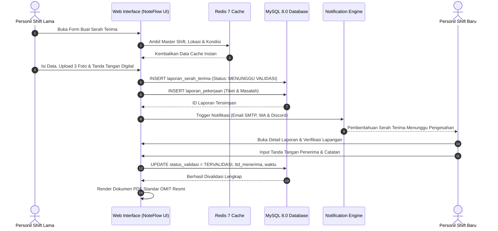

# Diagram Arsitektur & Relasi Sistem (System Diagrams)
## Sistem Laporan Serah Terima Shift Operasional (OMIT)

Dokumen ini memuat diagram visual lengkap yang mengilustrasikan relasi data dan urutan proses sistem.

---

### 1. Entity Relationship Diagram (ERD Lengkap)

```mermaid
erDiagram
    users {
        int id PK
        string nama_lengkap
        string username UK
        string password
        enum role "superadmin, admin, user"
        string jabatan
        string email
        string no_telepon
        string foto
        enum status "aktif, nonaktif"
        timestamp created_at
    }

    master_lokasi {
        int id PK
        string nama_lokasi
        string keterangan
        enum status "aktif, nonaktif"
        timestamp created_at
    }

    master_shift {
        int id PK
        string nama_shift
        time jam_mulai
        time jam_selesai
        time jam_serah_terima
        string keterangan
        enum status "aktif, nonaktif"
    }

    master_kondisi {
        int id PK
        string nama_kondisi UK
        string badge_color
        string keterangan
        tinyint is_default
        enum status "aktif, nonaktif"
        int urutan
        timestamp created_at
    }

    laporan_serah_terima {
        int id PK
        string nomor_laporan UK
        date tanggal
        int shift_id FK
        int lokasi_id FK
        time jam_serah_terima
        string kondisi_operasional
        int petugas_menyerahkan_id FK
        int petugas_menerima_id FK
        text catatan_penting
        string foto_1
        string ket_foto_1
        string foto_2
        string ket_foto_2
        string foto_3
        string ket_foto_3
        enum check_lisan
        enum check_tiket
        enum check_risiko
        enum check_kunci
        longtext ttd_menyerahkan
        string metode_ttd_menyerahkan
        longtext ttd_menerima
        string metode_ttd_menerima
        enum status_validasi "DRAFT, MENUNGGU VALIDASI, TERVALIDASI"
        datetime waktu_divalidasi
        int created_by
        timestamp created_at
    }

    laporan_pekerjaan {
        int id PK
        int laporan_id FK
        string no_tiket
        text pekerjaan_masalah
        enum prioritas "Tinggi / Kritis, Sedang, Rendah"
        enum status "Berjalan, Belum Mulai, Tertunda, Selesai"
        text kondisi_tindak_lanjut
        string pic
        string target_selesai
        int urutan
    }

    app_settings {
        string setting_key PK
        text setting_value
        timestamp updated_at
    }

    users ||--o{ laporan_serah_terima : "menyerahkan"
    users ||--o{ laporan_serah_terima : "menerima"
    master_shift ||--o{ laporan_serah_terima : "jadwal"
    master_lokasi ||--o{ laporan_serah_terima : "area"
    master_kondisi ||--o{ laporan_serah_terima : "status kondisi"
    laporan_serah_terima ||--|{ laporan_pekerjaan : "rincian pekerjaan"
```

---

### 2. Sequence Diagram: Handover & Dua Tahap Pengesahan

