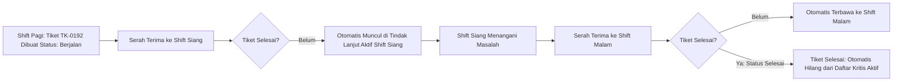
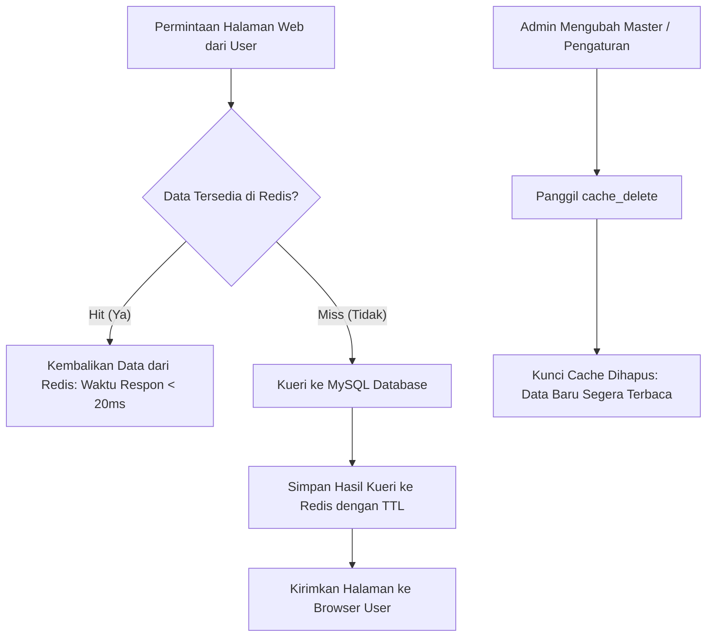

# Alur Kerja Sistem (Flowchart & Business Process)
## Sistem Laporan Serah Terima Shift Operasional (OMIT)

### 1. Diagram Alur Serah Terima & Persetujuan (Handover Workflow)

```mermaid
flowchart TD
    Start([Personil Shift Lama Selesai Bertugas]) --> BukaForm[Buka Menu Buat Serah Terima Baru]
    BukaForm --> IsiBag1[Isi Bagian 1: Waktu, Lokasi, Pilihan Kondisi Operasional]
    IsiBag1 --> CekTiketLama{Ada Tiket Menggantung / Kritis?}
    CekTiketLama -- Ya --> AutoImport[Sistem Menampilkan Opsi 'Oper ke Shift Baru']
    AutoImport --> IsiBag2[Isi & Lengkapi Rincian Pekerjaan & Tindak Lanjut]
    CekTiketLama -- Tidak --> IsiBag2
    
    IsiBag2 --> UploadFoto[Unggah 3 Foto Dokumentasi Lapangan + Keterangan]
    UploadFoto --> Checklist[Ceklis 4 Butir Konfirmasi Operasional]
    Checklist --> PilihTTD1[Pilih Metode TTD: Canvas / Barcode QR / Upload Basah]
    PilihTTD1 --> Simpan[Simpan Berita Acara: Status MENUNGGU VALIDASI]
    
    Simpan --> Notifikasi[Notifikasi Masuk ke Dashboard, Email SMTP & Discord]
    Notifikasi --> BukaPenerima[Personil Shift Baru Membuka Detail Laporan]
    BukaPenerima --> ReviewLapangan[Verifikasi Fisik Lapangan & Kesesuaian Catatan]
    
    ReviewLapangan --> ApprovalBox[Buka Kotak Persetujuan Penerima]
    ApprovalBox --> PilihTTD2[Tandatangani Penerimaan: Canvas / Barcode QR / Basah]
    PilihTTD2 --> Sahkan[Klik Setujui & Sahkan]
    
    Sahkan --> ValidatedStatus[Status Laporan Berubah: TERVALIDASI LENGKAP]
    ValidatedStatus --> GeneratePDF[Cetak PDF Standar OMIT Resmi A4]
    GeneratePDF --> Done([Selesai: Shift Baru Siap Beroperasi])
```

---

### 2. Diagram Alur Eskalasi Tiket Pekerjaan (Escalation Engine)

---

### 3. Diagram Alur Caching & Kinerja (Redis Cache Flow)

